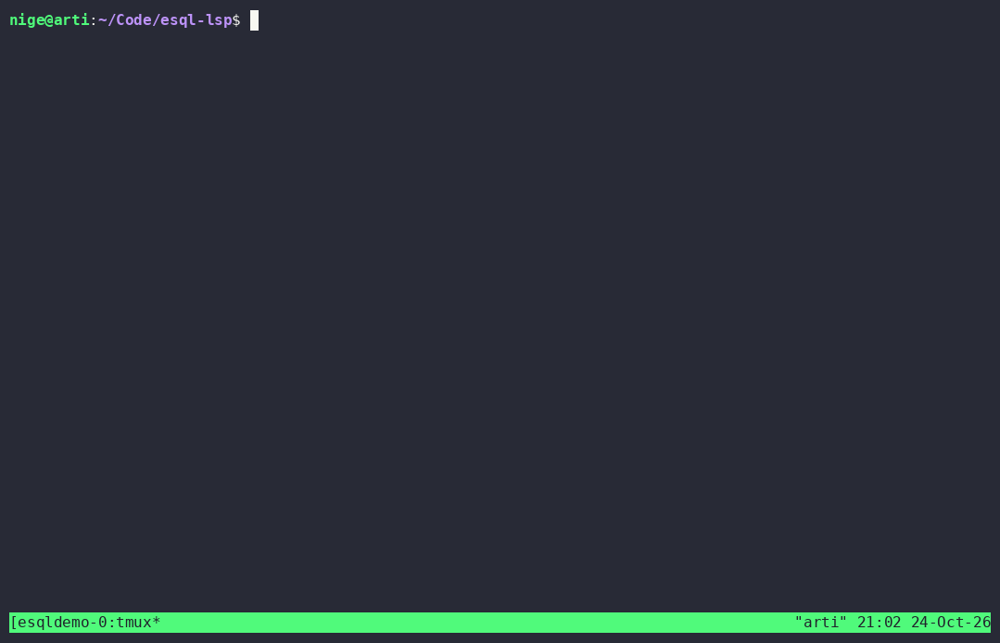

# esql-lsp

> ⚠️ **Vibe-coded software.** This project — code, grammar, tests and docs —
> was written almost entirely through AI-assisted coding sessions. It works
> (it has the test suite to prove it), but no human has audited every line.
> Use it, share it — and review it like any code you did not write yourself.
> Details: [Vibe-coded disclosure](#vibe-coded-disclosure).

A [Language Server Protocol](https://microsoft.github.io/language-server-protocol/)
server for **ESQL** — the transformation language of IBM App Connect
Enterprise (ACE) / Integration Bus (IIB).

Works with any LSP client; first-class configs are included for **Neovim**
and **OpenCode**.

> Phase 1: static analysis, completion, hover and document symbols —
> pattern-based on a comment/string-aware scanner.
> Phase 2 (landed): the **tree-sitter grammar** in
> [`tree-sitter-esql/`](tree-sitter-esql/) is integrated into the server —
> grammar-backed syntax errors, exact declared-variable analysis, semantic
> tokens, a parse-tree outline, go-to-definition, find-references,
> workspace-wide rename and quick fixes — with automatic fallback to
> heuristics when the native grammar cannot load (see [Roadmap](#roadmap)).

## Demo



The ~2-minute recording drives real Neovim against the real server
([`scripts/demo/`](scripts/demo/) holds its throwaway config, a fixture with
deliberate mistakes and a sibling file that declares what the flow shares):
diagnostics land inline on open, typing the missing `DECLARE` clears the
warning live, hover on `OutputRoot` shows the reference docs, omnifunc
completion offers the names this file declares, references and document
symbols come as lists — and `workspace/symbol` finds `CopyMessageHeaders`
in the **sibling** file, then jumps into it. A typed `CALL` and a `SET` of
the sibling's `SHARED` variable resolve with no warning (the workspace index
says they exist; a mistyped `SET FailureConceal = 1;` still warns — the check
kept its teeth), and the quick fix from the code-action picker inserts the
missing `DECLARE` and clears that warning. Go-to-definition then walks the
`CALL` into the sibling file, where renaming the `SHARED` declaration sweeps
**both** files and says so on screen; finishing the flow with `END MODULE;`
clears the structure errors. Every feature shown works identically without
the grammar addon — the heuristic fallback is the same tour, asserted green
(`ESQL_LSP_NO_GRAMMAR=1 scripts/record_demo.sh`).

Replay the committed cast locally with `asciinema play docs/demo.cast`, and
re-record it with `scripts/record_demo.sh` (needs tmux + asciinema; every
step asserts the pane, so a plain run doubles as an end-to-end UI test,
`--record` captures). The gif is `agg docs/demo.cast docs/demo.gif`.

## Features

### Diagnostics

| Check | Severity | Description |
|---|---|---|
| Syntax error / missing token | 🔴 Error | tree-sitter `ERROR` nodes plus recovered-but-inserted tokens (a missing `;` the parser silently repaired) — when the grammar is loaded. The messages never go silent: damage is named after its construct (`Syntax error in a SET statement.`), a found token is quoted with a keyword suggestion (`Unexpected 'SETN' here. Did you mean 'SET'?`), a statement that swallowed the next gets its missing `;` named at the exact slot, and an inserted `)` names the unclosed `(` it belongs to |
| Missing `END MODULE` | 🔴 Error | Module never closed — and the only diagnostic for that root cause even in grammar mode, where the damaged module header's own syntax message defers to it (one report per forgotten `END MODULE`) |
| Module without `Main()` | ⚠️ Warning | ACE cannot execute the module |
| `Main()` without `RETURN`/`PROPAGATE` | ⚠️ Warning | Message will not reach any terminal |
| Variable in `SET` without `DECLARE` | ⚠️ Warning | Grammar-exact when loaded; case-insensitive regex otherwise; function params count as declared |
| Variable `READ` without `DECLARE` | ⚠️ Warning | Expression reads (`SET x = Undeclared + 1`) — the write check above never saw them. Grammar path reads the tree; fallback mode scans conservatively (a subset, never a contradiction): clause words, DB statements, loop labels, literals and damaged files stay silent by design |
| Deprecated `XMLNS` parser | ⚠️ Warning | Use `XMLNSC` in ACE 12 |
| Legacy `LOGICAL` data type | 💡 Hint | Pre-ACE truth value; grammar accepts it (real legacy ESQL), the hint says prefer `BOOLEAN` — same in both modes |
| `CALL`/call of an unknown routine | ⚠️ Warning | Target declared neither in this file nor in the workspace index, and not a built-in — with a did-you-mean. Silent without a workspace root (or when the index skipped files): no root means no knowledge, not an error |
| Missing `;` at end of statement | 💡 Hint | Heuristic on statement starters (skipped when the grammar is loaded — real missing `;` become syntax errors then) |
| `OutputRoot.JSON.Data` set without Properties copy | 💡 Hint | Very common integration bug |

All checks run on a masked view of the source where comments and string
literals are blanked, so `'END MODULE'` inside a string cannot fake a module
boundary. With the grammar loaded, undeclared-variable analysis and syntax
errors come from the parse tree (exact ranges, multi-line aware); intact
statements inside a broken region are still analysed. Given a workspace root,
the undeclared check also counts `DECLARE … SHARED` names from sibling files
as declarations (see *Workspace* below); without one it stays file-local.

Most findings come with a one-keystroke repair — see
[Quick fixes](#quick-fixes) below.

Every diagnostic also carries `source: "esql"`, a stable `code`, and a
`codeDescription` link to the section below, so a client can group by owner,
suppress one check without matching message text, or offer "explain this
problem". The codes mirror the setting names below: `syntax-error`,
`missing-end-module`,
`module-no-main`, `no-propagation`, `unclosed-main`, `undeclared-variable`,
`undeclared-read`, `deprecated-parser`, `deprecated-type`, `unknown-routine`, `missing-semicolon`, `output-root-properties`.

### Completion

- 46 built-in ESQL functions with signature + markdown documentation
- Keywords, data types, message tree variables (`InputRoot`, `Environment`, …)
- Context-sensitive: parser domains after `InputRoot.`/`OutputRoot.`,
  `Data` plus a Properties copy-hint after `.JSON.`, common
  `LocalEnvironment` fields, an honest datasource placeholder after
  `Database.`, types after `DECLARE <name>` / `RETURNS`
- Clause-aware narrowing (`PROPAGATE TO ` → TERMINAL/LABEL, `SET ref ` →
  `= TYPE NAMESPACE NAME VALUE`, …) is **clause**-aware in grammar mode, not
  line-aware: the parse tree hands the table the true multi-line prefix, so
  a clause wrapped across lines (`SET`⏎`x `) narrows exactly like its
  single-line form — asserted for every rule in the table. The words always
  come from that one shared table, so heuristic mode is untouched, and where
  the tree cannot be trusted (damage before the cursor, a mid-typed clause
  recovery swallowed) the line table answers exactly as before
- Variables declared in the current document (each name of a multi-name
  `DECLARE a, b, c` included), **in scope at the cursor only** — a name
  declared in another routine is not offered, and one declared outside the
  module is not offered past `END MODULE`
- The file's own `CREATE FUNCTION|PROCEDURE` names, signature and all — a
  `CALL` target is a completion, not just the built-in table; with a
  workspace root, sibling routines and `SHARED` variables join too and name
  their file (`in helper.esql · FUNCTION Helper() RETURNS BOOLEAN`,
  `SHARED, declared in helper.esql`). Same-file names win the dedupe, and
  these names never leak into a clause-narrowed list (`=`, types, VALUE
  lists stay closed)
- 44 snippets (module skeletons, IF/CASE/WHILE, THROW, PASSTHRU, JSON
  responses, …) — triggered like `module-compute`, `throw`, `trycatch`
- **Deferred deliberately: model-driven field completion.** Deeper message
  tree paths (`XMLNSC.<root>`, `MRM.<model>.…`, BDF/XSD-derived structures)
  get placeholder items that *say so in the item*. Completing the actual
  fields of a message means parsing message models (XSD/MRM/BDF), which is
  its own project phase — the server will not fake field knowledge it does
  not have. The static lists it does offer are documented and honest about
  being static
- The **whole** context-relevant list ships on every keystroke — the server
  stopped pruning by prefix, so your client's fuzzy/subsequence matcher sees
  every candidate (`datetype` can still find `DATETIME`); items carry
  `filterText`/`sortText` so clients know how to match and rank them, and
  clause positions (`DELETE F…`) stay narrowed and prefix-filtered as the
  context permits. One item per label, so a word that is both a keyword and
  a data type (`INTEGER`) is offered once

### Hover

Markdown documentation for built-in functions, message tree variables,
parser domains and data types — and for the document's own symbols: a
`DECLARE` (its type, `CONSTANT`, and the routine or module that owns it) and a
user-defined `FUNCTION`/`PROCEDURE` (its full header line). A name you declared
wins over a built-in of the same spelling, so hovering your own `LENGTH`
documents your `DECLARE`, not `LENGTH()`. Resolved in scope: with `value`
declared in two routines, hovering inside `Second()` documents `Second()`'s
declaration, and go-to-definition at the same cursor agrees with it.

### Document symbols

`BROKER SCHEMA` namespace, modules, functions/procedures (with params and body
range) and declared variables — routines and module-level `DECLARE`s nested
under their module, parameters and body `DECLARE`s under their routine. Built
from the parse tree when it is loaded, otherwise from the same pattern
extractor the definition and hover paths use, so both modes outline the same
names (every name of a multi-name `DECLARE a, b, c` included).

The answer takes the shape the client declared: with
`textDocument.documentSymbol.hierarchicalDocumentSymbolSupport` the nested
`DocumentSymbol[]`, without it the flat `SymbolInformation[]` list (`location`
per entry, `containerName` naming the parent) — a client that never declared the
capability cannot render `children`, so it used to lose everything below module
level.

### Go to definition and find references

Jump from `SET orderRef = …` or `CALL ValidateOrder(…)` to the `DECLARE` or
`CREATE` it belongs to, and list every use of a name with or without the
declaration itself. Scope-aware: a routine parameter is only found inside its
own routine, a module-level `DECLARE` from every routine of the module.
Message-tree path parts (`OutputRoot.JSON.**Data**`) and built-ins resolve to
nothing rather than to a guess. Available in both modes; the grammar-backed path
keeps working while the file is still broken — a module whose `END MODULE` is
still being typed still owns its routines and declarations.

### Rename

`prepareRename` + `rename` over the same `referencesAt` engine find-references
uses, so what you saw under *references* is exactly what changes — quoted
names included (`DECLARE "my var"` rewrites to `"other name"`, quotes kept).
Renames a body/module variable, a routine parameter (ESQL calls are
positional, so a parameter can never break a caller) or a routine, and fixes
casing for free (`total` → `Total` rewrites every occurrence).

`SHARED` variables and routines reach other files, so with a workspace root
their rename goes **workspace-wide**: every file the index can see is scanned
at request time — open buffers from their live text, disk files re-read fresh
(a file changed outside the editor since the scan is still renamed
correctly) — and `CALL`s in sibling files follow the routine. A `SHARED`
rename that touched other files says so out loud: `window/showMessage` states
that ACE keeps `SHARED` scope *application*-wide and files outside the
workspace may still use the old name, and clients that accept
`documentChanges` get the same note as a change annotation in their edit
preview. Without a root this file is the entire visible world, so the
file-local rename is complete and allowed.

Refusals come with a reason, and `prepareRename` answers them too, so a good
client blocks at `F2` instead of after you type:

- **not a renameable symbol here** (`Main()`, module names, `BROKER SCHEMA`,
  namespace aliases, path elements, comments, undeclared names) — silent
  `null`, the UI greys out;
- **a bad new name** — not an identifier, an ESQL *reserved* keyword (the 12
  that "you cannot use for variable names"; non-reserved ones are only
  discouraged, so they stay allowed), a name the file already answers to
  (ESQL is case-insensitive), a `"` inside a quoted name, or — for a
  workspace-wide rename — a `SHARED`/routine name a **sibling** already
  declares (that would create the application-level clash);
- **a workspace the rename cannot see completely** — the bounded scan skipped
  a file (size/count limits) or a file became unreadable: a partial rename
  would leave uses behind, so the refusal names the bound instead.

Identical answers in both modes (asserted over real stdio sessions, in
grammar and in `ESQL_LSP_NO_GRAMMAR=1` mode — the cross-file half is
pattern-based by construction).

### Quick fixes

`codeActionProvider` (quickfix kind): every published diagnostic that has a
mechanical repair offers it where the squiggle is — `Ctrl-.` in VS Code,
`:CodeActionMenu`-style pickers in Neovim. The fixes:

| Diagnostic | Fix |
|---|---|
| `deprecated-parser` | `XMLNS` → `XMLNSC` in place |
| `deprecated-type` | `LOGICAL` → `BOOLEAN` in place |
| `missing-end-module` | `END MODULE;` appended at EOF, indented like the module header |
| `no-propagation` | `RETURN TRUE;` as Main's last body statement |
| `output-root-properties` | `SET OutputRoot.Properties = InputRoot.Properties;` inserted at the routine head |
| `undeclared-variable` / `undeclared-read` | `DECLARE <name> CHARACTER;` skeleton at the routine head — with a `DECLARE … <TYPE>` variant first when the flagged line itself says `CAST(… AS <TYPE>)` (the type is never invented); plus *use the declared name* replacements for the did-you-mean candidates, up to three, nearest first |
| `unknown-routine` | *call this instead* replacements for the did-you-mean candidates, up to three |
| `missing-semicolon`, and any `syntax-error` whose message names `';'` | `;` at the slot the message points at |

What has no fix is also deliberate: `module-no-main` and `unclosed-main`
describe a missing routine and a missing `END` no skeleton could honestly
write, and other `syntax-error` messages carry no single-edit repair.

The contract: fixes are recomputed from the document's **current** text, so
a client echoing stale diagnostics never gets an edit anchored in old
positions; each fix obeys the toggle of the check that owns it (check off,
fix off — echo included); inserting fixes land where ESQL wants them
(declarations before statements, at the routine head), not beside the
flagged line; and every action points back at the diagnostic it clears.
Both analysis modes answer the same actions at the same ranges — asserted
literally over stdio in grammar and heuristic mode, with every transform
unit-tested by *applying* it and re-running the checks: the finding must be
gone.

### Workspace (cross-file)

ACE applications split across `.esql` files that share state through
`DECLARE … SHARED` variables and reach each other through `CALL`. Given a
workspace root (`workspaceFolders`/`rootUri`), the server scans the tree for
`.esql` files once after startup — bounded: ≤ 500 files, ≤ 256 KB each, junk
directories skipped — and every open buffer's live text overrides its on-disk
snapshot. Four things follow:

- the **undeclared-variable check** honours `DECLARE x SHARED …` from sibling
  files, so `FailureCount` declared in `Receiver.esql` is no longer reported
  in `ReceiverExceptionHandler.esql` (without a workspace root the check
  stays file-local — and it never suppresses names wholesale);
- **`workspace/symbol`** answers a flat, query-filtered outline — modules,
  routines, BROKER SCHEMAs — from the scan plus open buffers;
- **cross-file navigation**: go-to-definition from a `CALL` target or a
  sibling-declared `SHARED` variable jumps into the declaring file, hover
  there shows the signature synthesized from the index, and find-references
  sweeps every visible file for the name — including files that merely USE
  it. A routine name the current file itself declares while a sibling also
  declares it stays file-local (the local shadow: ten `Main()`s are ten
  routines);
- **cross-file rename** for `SHARED` variables and routines, rewriting every
  visible use — see [Rename](#rename).

Two deliberate approximations: "workspace-wide" stands in for ACE's
*application-wide* `SHARED` scope (an LSP has no application boundary — a
workspace-wide rename therefore *states* that limit instead of hiding it), and
there is no file watcher — files changed outside the editor are picked up on
the next server start (rename still re-reads disk files at request time, so
its cross-file edits never target stale text). The scan uses the same extractors as heuristic mode,
so all of this works with or without the grammar addon. Without a root,
`workspace/symbol` still answers from the open buffers.

## Requirements

- Node.js >= 18 (server runtime)
- TypeScript toolchain only for building
- **Optional (recommended):** a C toolchain (cc/python/make) so
  `npm install` can build the tree-sitter native addon. Without it the
  server still runs — with the Phase 1 heuristics only (no grammar syntax
  errors or semantic tokens); it logs which mode is active at startup.

Installing a published package needs nothing extra: the grammar travels *inside*
the tarball (`vendor/tree-sitter-esql`, since it is not on the npm registry) and
a best-effort `postinstall` compiles its addon. No toolchain, or
`npm install --ignore-scripts`? The install still succeeds and the server runs in
heuristic mode.

## Build

```sh
npm install
npm run build
```

Install the `esql-lsp` binary on your PATH:

```sh
npm link
# or, for a project-local install:
npm install -g /path/to/esql-lsp
```

Verify:

```sh
npm test          # unit + end-to-end LSP session over stdio
esql-lsp --help   # (any args) starts the stdio server; Ctrl-C to quit
```

### ESQL grammar (tree-sitter)

The grammar in [`tree-sitter-esql/`](tree-sitter-esql/) is a standalone
npm package (and directly consumable by nvim-treesitter):

```sh
cd tree-sitter-esql
npm install          # builds the Node addon (N-API) from binding.gyp
tree-sitter test     # 86 corpus tests in test/corpus/
```

- [`tree-sitter-esql/grammar.js`](tree-sitter-esql/grammar.js) — permissive
  superset of the IBM ACE 12.0.x ESQL railroad diagrams.
- [`tree-sitter-esql/queries/highlights.scm`](tree-sitter-esql/queries/highlights.scm) —
  highlight query (scope `source.esql`) for nvim-treesitter.
- [`tree-sitter-esql/VERIFICATION.md`](tree-sitter-esql/VERIFICATION.md) —
  construct-by-construct evidence against the IBM ESQL reference, gaps
  found/fixed and known limitations.
- [`tree-sitter-esql/README.md`](tree-sitter-esql/README.md) — grammar
  status, standalone usage, regeneration workflow.

### Development

```sh
npm test                       # build + 240 unit/e2e tests (real stdio sessions)
npm run grammar:test           # 86 grammar corpus tests (tree-sitter test)
ESQL_LSP_NO_GRAMMAR=1 npm test # heuristic mode: grammar-only cases skip, the rest must pass
npm run smoke:stdio            # start the built server and check that it answers
npm run verify:package         # pack, install the tarball, use the installed server

cd tree-sitter-esql
tree-sitter generate           # grammar.js -> src/parser.c (committed output!)
tree-sitter test               # 86 corpus tests
```

Generated grammar sources (`src/parser.c`, `src/node-types.json`, …) are
committed so consumers never need the tree-sitter CLI — regenerate them
with `tree-sitter generate` after editing `grammar.js`, never hand-edit.
Conventions, ground rules and what makes a good PR:
[CONTRIBUTING.md](CONTRIBUTING.md).

## Neovim setup

A complete, self-contained example (filetype + server + keymaps) lives in
[`clients/neovim/init-example.lua`](clients/neovim/init-example.lua).
The essentials:

1. **Filetype mapping** — put
   [`clients/neovim/ftdetect/esql.vim`](clients/neovim/ftdetect/esql.vim)
   into your `ftdetect` directory (or add manually):

   ```vim
   au BufNewFile,BufRead *.esql set filetype=esql
   ```

2. **Start the server.** On Neovim ≥ 0.11 use the modern
   `vim.lsp.config` API:

   ```lua
   vim.lsp.config('esql', {
     cmd = { "esql-lsp" },  -- or { "node", "/abs/path/to/esql-lsp/dist/src/server.js" }
     filetypes = { "esql" },
     -- IMPORTANT: fall back to the file's own directory. If no root can be
     -- resolved, vim.lsp.enable() silently never starts the server.
     -- A root_dir FUNCTION must call on_dir(); vim.lsp.enable() ignores
     -- return values, so a returning function silently never starts.
     root_dir = function(bufnr, on_dir)
       on_dir(vim.fs.root(bufnr, { ".git", "opencode.json", "project.xml" })
         or vim.fs.dirname(vim.api.nvim_buf_get_name(bufnr)))
     end,
   })
   vim.lsp.enable('esql')
   ```

   On Neovim 0.8 – 0.10 use the `vim.lsp.start` style from
   [`clients/neovim/lsp/esql.lua`](clients/neovim/lsp/esql.lua):

   ```lua
   vim.api.nvim_create_autocmd("FileType", {
     pattern = "esql",
     callback = function()
       vim.lsp.start({
         name = "esql-lsp",
         cmd = { "esql-lsp" },   -- or { "node", "/abs/path/to/esql-lsp/dist/src/server.js" }
         root_dir = vim.fs.root(0, { ".git", "opencode.json", "project.xml" })
           or vim.fs.dirname(vim.api.nvim_buf_get_name(0)),
         filetypes = { "esql" },
       })
     end,
   })
   ```

   Verify with `:checkhealth vim.lsp` — an `esql` client should be listed
   as active with your buffer attached.

> **Syntax highlighting:** the LSP itself emits **semantic tokens** (driven
> by the grammar's `queries/highlights.scm`), which Neovim ≥ 0.10 renders
> with its built-in tree-sitter theme — no extra setup. For editor-side
> tree-sitter highlighting instead, see
> [`clients/neovim/treesitter/esql.lua`](clients/neovim/treesitter/esql.lua)
> (nvim-treesitter wiring for the local grammar). The LSP features
> (diagnostics, completion, hover, outline) work either way.

## OpenCode setup

LSP support is disabled by default in OpenCode. Merge the `lsp` section from
[`clients/opencode/opencode.jsonc`](clients/opencode/opencode.jsonc) into your
project's `opencode.json` / `opencode.jsonc`:

```jsonc
{
  "$schema": "https://opencode.ai/config.json",
  "lsp": {
    "esql": {
      "command": ["esql-lsp"],
      "extensions": [".esql"]
    }
  }
}
```

OpenCode then starts the server on first contact with a `.esql` file and
feeds published diagnostics back to the agent as feedback while it edits.

## Troubleshooting

- **Nothing happens when I open a `.esql` file.** The client probably
  never attached (or never started). Neovim: `:checkhealth vim.lsp` → the
  server must appear under *Active Clients*. The classic silent failure is
  an unresolvable root directory — see the `root_dir` note in
  [Neovim setup](#neovim-setup).
- **Which analysis mode is the server in?** At startup it logs either
  `esql-lsp: tree-sitter grammar loaded — grammar syntax errors + semantic
  tokens active` or `esql-lsp: tree-sitter grammar unavailable, heuristics
  only: <reason>` (forced off prints `esql-lsp: ESQL_LSP_NO_GRAMMAR is set —
  heuristics only`). Heuristic mode still gives every Phase 1 check plus symbols, hover,
  definitions and references from patterns, but no grammar syntax errors or
  semantic tokens; it happens when the native addon could not build (needs a C
  toolchain at `npm install` time) or was skipped (`--ignore-scripts`).
  Neovim: `:lua vim.lsp.log.set_level('info')`, then `:LspLog`.
- **Rename refuses and shows a sentence instead of an input box.** That is
  the answer, not a failure: the new name collides with one the file (or,
  for `SHARED`/routine renames, a sibling) already answers to, or the
  workspace rename cannot be done completely (the bounded scan skipped a
  file), or it is `Main()` — ACE calls that routine by name. `SHARED` names
  and routines themselves rename workspace-wide whenever a root exists;
  ordinary variables always rename, with or without a root.
- **A file with Windows (`\r\n`) or old-Mac (`\r`) line endings.** Fine in both
  modes: the server splits lines the way an LSP client does — `\r\n`, `\r` or
  `\n`, terminator excluded — so symbols, hover, diagnostics and semantic tokens
  land on the row the editor shows, and no token is painted past end-of-line.
  Internally the text is normalised for the parser only; your buffer is never
  rewritten. If ranges ever look shifted by a line, that is a bug worth filing.
- **Want the heuristic mode on purpose** (to compare, or to work around a broken
  build)? Start the server with `ESQL_LSP_NO_GRAMMAR=1`; the test suite uses the
  same switch to prove the fallback stays good.
- **Changed the server code, nothing happened.** Clients spawn the built
  `dist/src/server.js` — run `npm run build`, then restart the client
  (`:LspRestart` in Neovim).
- **Diagnostics look wrong/missing?** Before blaming your editor, confirm
  what the server publishes: `test/e2e.test.ts` shows the exact stdio
  handshake to replay a session by hand.

## Configuration

Passed as LSP `initializationOptions` (Neovim: `settings` in
`vim.lsp.start`; OpenCode: `initialization` in the `lsp` entry). All default
to `true`:

```jsonc
{
  "diagnostics": {
    "enabled": true,
    "checkSyntaxErrors": true,
    "checkUndeclaredVariables": true,
    "checkUndeclaredReads": true,
    "checkPropagation": true,
    "checkMissingSemicolon": true,
    "checkDeprecatedParsers": true,
    "checkDeprecatedTypes": true,
    "checkUnknownRoutines": true,
    "checkOutputRootProperties": true
  },
  "completion": {
    "enabled": true
  }
}
```

Settings apply at startup and can be updated at runtime through the
standard `workspace/didChangeConfiguration` notification (section form
`{ "esql": { ... } }` or the object directly).

## Project layout

```
bin/esql-lsp.js        # executable entrypoint (requires dist/src/server.js)
src/server.ts          # LSP wiring (stdio JSON-RPC)
src/parser.ts          # tree-sitter integration (grammar, tokens; degrades gracefully)
src/suggest.ts         # bounded edit-distance "did you mean" candidates
src/scanner.ts         # comment/string-aware masking scanner
src/diagnostics.ts     # the diagnostic checks (12 published codes, 9 switches)
src/completion.ts      # context-sensitive completion
src/hover.ts           # hover documentation
src/symbols.ts         # document symbols (parse tree + pattern fallback)
src/definitions.ts     # declarations/routines/references, go-to-definition, find-references
src/codeActions.ts     # quick fixes, recomputed from the document's current text
src/workspaceIndex.ts  # bounded workspace scan: sibling SHARED names, workspace/symbol
src/settings.ts        # initializationOptions / didChangeConfiguration handling
src/data/esqlData.ts   # keywords, types, tree vars, domains, functions
src/data/snippets.ts   # 44 LSP snippets
scripts/               # prepack vendoring, addon build, packaging + stdio smoke checks
scripts/record_demo.sh # feature demo tour: verify run = e2e UI test, --record = cast
scripts/demo/          # recorded demo's nvim/tmux config + fixtures
docs/                  # demo.cast + demo.gif (the README demo)
test/                  # node:test unit + e2e (real stdio LSP sessions)
clients/neovim/        # ready-to-use configs: modern (init-example.lua),
                       # legacy (lsp/esql.lua), filetype, treesitter example
clients/opencode/      # OpenCode config example
tree-sitter-esql/      # tree-sitter ESQL grammar — own package (see its README)
vendor/                # generated at pack time: grammar copy for the published tarball
ATTRIBUTION.md         # upstream projects & documentation credited
CONTRIBUTING.md        # dev setup, ground rules, PR guide
```

## Roadmap

- **Phase 2 — grammar integration.** ✅ Complete: syntax-error diagnostics,
  exact undeclared-variable analysis, tree-based declared-name completion,
  semantic-token highlighting, document symbols from the parse tree, and
  go-to-definition / find-references for declared variables, parameters and
  user routines. Every one of these keeps a pattern-based fallback and is tested
  in both modes (`ESQL_LSP_NO_GRAMMAR=1 npm test`).
- **Grammar coverage.** Adjudicated against the live ACE 12.0.x reference
   (2026-10-29 pass, verdicts recorded per family in
   [`tree-sitter-esql/VERIFICATION.md`](tree-sitter-esql/VERIFICATION.md)):
   the previously open shapes resolved to deliberate rejections — `COPY` and a
   `SELECT` *statement* don't exist in ESQL, `LOG TERMINAL`, flat `ELSE IF`,
   `DECLARE … LIST OF`, `CALL r(IN a, OUT b)` and DB2 routine characteristics
   (`DETERMINISTIC`, `NO SQL`, …) are not ESQL — while the grammar's one real
   bug in that set shipped fixed: `LOG … ;` without the optional `VALUES`
   clause is now accepted. Left open: the plural interval qualifiers
   (`INTERVAL '1' DAYS`) — that diagram page could not be reached during the
   pass, and per the ground rule the grammar does not loosen without the
   reference. The no-12.0.x-page group (`DECIDEMODE`-style `PROPAGATE`
   clauses, `ASJSON`/`TOMIME` options) stays as the grammar has it. Deciding
   each one needs the reference, not the test suite.
 - **Phase 3 — model-driven features.** MRM/XSD schema import for message-tree
   field completion, formatting. The workspace index now exists and is used:
   `workspace/symbol`, SHARED-aware undeclared check, cross-file
   go-to-definition / find-references / hover, and SHARED-aware completion
   (`CALL` targets and `SHARED` variables offered with their declaring
   file), cross-file find-references across every visible file, and
   workspace-wide rename of `SHARED` variables and routines (with the
   application-scope approximation surfaced in the message, not hidden).
- Longer term: optional integration with the ACE ESQL compiler for
  authoritative validation.

## Attribution

This project builds on the work of others, and we want that on the record:
keyword/function data, diagnostic rule ideas and snippets derive from
[esql-vscode](https://github.com/joaquinvulcano/esql-vscode) (Joaquín
Vulcano, MIT); the grammar is built with **tree-sitter** and its template;
the server runs on Microsoft's **vscode-languageserver**; and the grammar's
accepted language was verified construct-by-construct against **IBM's ACE
ESQL railroad diagrams**. Full credits: [ATTRIBUTION.md](ATTRIBUTION.md).

## Vibe-coded disclosure

This repository is what people now call **vibe-coded**: an AI coding agent,
in close iterative sessions with a human, produced essentially all of it —
the server, the tree-sitter grammar, the 320+ corpus/unit/e2e tests, and
the documentation. Practical consequences:

- **The tests are green, but the same tool wrote the code and the tests.**
  They encode its understanding of ESQL: strong evidence, not a proof.
- **The grammar was validated against the published IBM railroad diagrams
  and a hand-built corpus — never against the ACE compiler itself.** Known
  deviations are listed in `tree-sitter-esql/VERIFICATION.md`; unknown ones
  certainly exist. Treat "no diagnostics" as *probably fine*; the ESQL
  compiler remains the only authority.
- Naming, structure and prose are machine-templated; expect seams.

The human role was direction, scope and correctness judgment — including
running this through real Neovim sessions and fixing what bit us (a
silently-repaired missing `;`, a false-positive on multi-name `DECLARE`s,
invalid test fixtures). If you audit it and find warts — that is the
point of publishing it — open an issue or PR. AI-assisted contributions
are welcome; disclose them and ship test evidence.

## License

[MIT](LICENSE)
